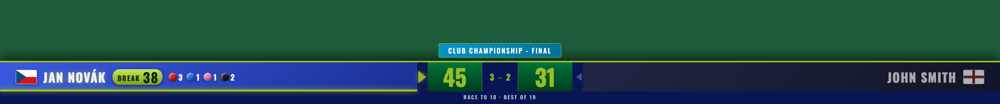
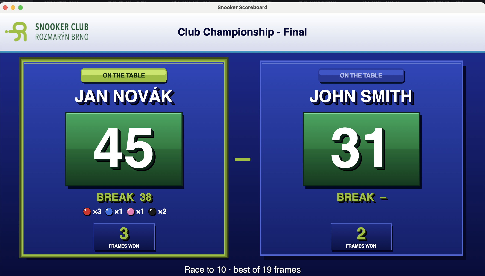
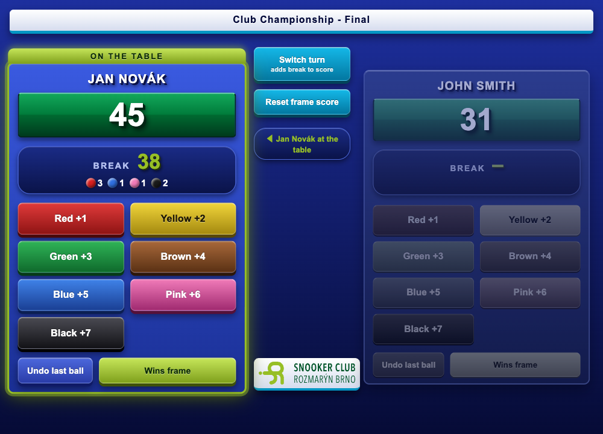
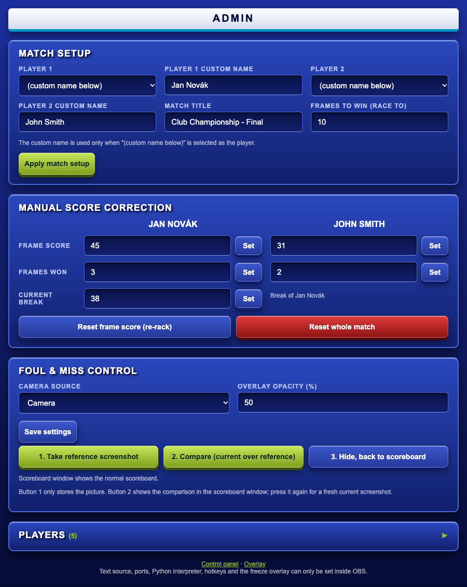

# obs-snooker

Snooker scoreboard for OBS Studio: a browser overlay for the stream, a scoreboard window for a second monitor,
a touch-friendly control panel, an admin page and a "foul & miss" screenshot comparison tool.



| Scoreboard window (second monitor) | Control panel (phone / tablet) |
|:--:|:--:|
|  |  |

## What it does

`obs-snooker` is a script for OBS Studio that keeps the score of a snooker match and shows it in several places at once,
all fed from one shared match state, so they never disagree:

1. **Broadcast overlay** (OBS Browser Source) - a TV-style lower-third bar over the camera feed.
2. **Scoreboard window** - a big, scalable window for a second monitor (referee, players, audience in the room).
3. **Control panel** - touch-friendly web page for scoring from a phone, tablet or the same PC.
4. **Admin page** - match setup, player roster, score corrections and the foul & miss tool.
5. **Plain OBS text source** (optional) - a one-line summary such as `>Alice 4 (45) - (12) 3 Bob` for simple setups.

### Features

**Scoring that follows real snooker rules**
- Two scores per player: **frames won** (the match score, race to *N*, best of *2N-1*) and the **points in the current frame**.
- **Break tracking:** every potted ball (red 1, yellow 2, green 3, brown 4, blue 5, pink 6, black 7) goes into the current
  *break* of the player at the table. The break is added to the frame score when you switch the turn.
  "Wins frame" and "Reset frame score" discard a pending break.
- **Potted balls of the break** are shown as coloured balls with counts (e.g. red x3, blue x1) in the overlay,
  the control panel and the scoreboard window. **Undo last ball** removes the last ball and its points.
- **Turn indicator:** the player at the table is highlighted (arrow, glow, "ON THE TABLE"); the other player is locked
  in the control panel so a wrong player cannot be scored by mistake.
- **Winner detection** when a player reaches the race length; the turn alternates automatically after a frame.
- **Manual correction** of frame score, frames won and break (admin page or OBS Scripts panel) and a re-rack/reset.
  *Reset whole match* is deliberately only available in the admin page and the Scripts panel (with confirmation)
  and has no hotkey.

**Presentation**
- Club colours (SC Rozmarýn Brno: blue, navy, lime green) with a 3D look and the club logo.
- **Overlay:** full-width lower third with country flags (85 flags included), frame-score boxes, small frames-won pill,
  break chip with potted balls, match title and race label. The active player is clearly lit, long names shrink
  automatically, the page background is transparent.
- **Scoreboard window:** scales to any window size/monitor (not only 1920x1080), F11 = fullscreen, Esc = leave fullscreen.
  It runs as a separate process and re-reads the score several times per second.

**Players and match setup**
- A reusable **player roster** (name + 3-letter country code for the flag), sorted by surname, stored in `players.json`.
- Pick players from the roster or type a custom name for a one-off match; set the match title and race length.

**Controlling a live match** - use whatever suits you, they all work together:
- the **control panel** in a browser (phone/tablet on the LAN supported),
- **OBS hotkeys** (Settings -> Hotkeys, search "Snooker"): per-ball potting for both players, +/- points, wins frame,
  switch turn, reset frame, freeze overlay actions,
- buttons in the script's **Scripts panel** in OBS.

**Foul & miss control (referee tool)**
- Restores a disturbed table: store a camera picture as the *reference*, later show a fresh picture semi-transparently
  over it in the scoreboard window and nudge the balls back into place. Details below.
- The older **freeze overlay** in OBS (Scripts panel/hotkeys) does the same directly in an OBS scene: it shows a
  semi-transparent screenshot of the camera on top of the live feed.

**Other**
- **Crash-safe:** the match progress (frames, frame scores, break and its balls, whose turn it is) is saved to
  `match_state.json` next to `obs-snooker.py` within half a second of every change and restored when the script loads
  (after an OBS crash/restart or "Reload Scripts"). Start a fresh match with *Reset whole match*.
- Works on macOS and Windows (screenshots and instructions are for Windows; development was done on macOS).
- The web pages are served by a small built-in HTTP server on port `8710`; no internet connection is needed
  (only the optional Oswald web font falls back to a system font without it).
- "Reload Scripts" in OBS is enough after changing any file; no restart needed.

## Pages

| What | Where |
|------|-------|
| Broadcast overlay (OBS Browser Source) | `http://127.0.0.1:8710/overlay` |
| Control panel (scoring buttons, phone/tablet friendly) | `http://127.0.0.1:8710/control` |
| Admin (players, match setup, score correction, foul & miss control) | `http://127.0.0.1:8710/admin` |

The port (default `8710`) can be changed in the script's properties in OBS.

## Installation on Windows 10 / 11

1. **OBS Studio** 28 or newer (64-bit), from <https://obsproject.com>.
2. **Python 3.11, 64-bit**, from <https://www.python.org/downloads/windows/>.
   During installation tick **"tcl/tk and IDLE"** (needed for the scoreboard window; it is on by default)
   and optionally "Add python.exe to PATH". Use the *same bitness* as OBS (64-bit).
3. Copy this project folder somewhere permanent, e.g. `C:\obs-snooker` (avoid folders that sync or move).
4. Install the dependencies. In *Command Prompt* or *PowerShell*:
   ```
   cd C:\obs-snooker
   py -3.11 -m pip install -r requirements.txt
   ```
   (`pynput` for the keyboard listener, `Pillow` for the semi-transparent screenshot blend in the scoreboard window.)
5. In OBS: **Tools -> Scripts -> Python Settings** -> *Python Install Path* = the folder with `python.exe`,
   e.g. `C:\Users\<you>\AppData\Local\Programs\Python\Python311`
   (find it with `py -3.11 -c "import sys; print(sys.exec_prefix)"`). Restart OBS if it asks.
   The tab should then show "Loaded Python Version: 3.11".
6. **Tools -> Scripts -> "+"** -> select `C:\obs-snooker\obs-snooker.py`.
7. The script log (button "Script Log") should print the overlay, control and admin URLs, and a window
   "Snooker Scoreboard" opens.

### If the scoreboard window does not open

The window is a separate process started with your Python. If auto-detection fails, set
**"Python interpreter (for scoreboard window)"** in the script properties to the full path, e.g.
`C:\Users\<you>\AppData\Local\Programs\Python\Python311\python.exe`, then press "Show scoreboard window".

## Setting up the scene

1. **Overlay:** add a *Browser* source, URL `http://127.0.0.1:8710/overlay`, size `1920x1080`
   (a transparent background is used, leave the custom CSS empty). Place it above the camera.
2. **Scoreboard window:** drag it to the second monitor and press **F11** for fullscreen (Esc to leave).
3. **Control panel:** open `http://127.0.0.1:8710/control` in a browser, or from a phone/tablet on the same Wi-Fi
   using the LAN address printed in the script log (e.g. `http://192.168.1.20:8710/control`).
4. **Windows Firewall:** the first start shows a prompt for OBS / Python - allow **Private networks**,
   otherwise phones cannot connect. The control and admin pages have no password; use them only on a trusted network.

## Using it

- **Control panel:** only the player at the table can score. Balls add to the *break*; the break is added to the
  frame score on "Switch turn". "Wins frame" and "Reset frame score" discard the pending break.
- **Admin:** 

  choose players from the roster (or a custom name), match title, race length; correct scores; manage
  the player roster (name + 3-letter country code, e.g. `CZE`, `ENG`).
- **Hotkeys:** OBS *Settings -> Hotkeys*, search for "Snooker".
- **Foul & miss control** (admin page; shown only when running inside OBS):
  1. Select the *camera source* and opacity, press **Save settings**.
  2. **1. Take reference screenshot** - only stores the camera picture before the disturbance (nothing is shown yet).
  3. **2. Compare** - the scoreboard window shows a fresh screenshot semi-transparently over the reference; press again for a new current picture.
  4. **3. Hide** - back to the scoreboard.
  Screenshots are taken via OBS and read from OBS's *recording* output folder (Settings -> Output -> Recording Path),
  so that folder must exist and be writable.

## Windows 7 / 8

Not officially supported. OBS 28+ requires Windows 10 or newer. The last OBS for Windows 7/8 is 27.2.4 with
Python 3.8 as the newest usable interpreter (last Python for Win 7). The project uses only Python 3.7+ syntax
(`from __future__ import annotations`), so it *may* work there, but it has not been tested, and the screenshot
API used by the foul & miss control may be missing in old OBS versions (the other features don't need it).
Recommended: update to Windows 10/11.

## Troubleshooting

- **"ModuleNotFoundError" in the script log:** OBS's *Python Install Path* is wrong or points to another Python than
  the one where you ran `pip install`.
- **Overlay is blank:** open the URL in a normal browser first; check the port and that the script loaded.
- **Scoreboard window has no blend / only one image in foul control:** Pillow is missing in the Python used for the window.
- **After editing files:** *Tools -> Scripts -> Reload Scripts* is enough (no OBS restart needed).
- **Match progress is stored in** `match_state.json` next to `obs-snooker.py` (delete it or use *Reset whole match* to start clean).
- **Players are stored in** `players.json` next to `obs-snooker.py`.

## Development

```
pip install -r requirements.txt -r requirements-dev.txt
python -m pytest
python -m obs_snooker.overlay_server        # preview server with demo data
python -m obs_snooker.scoreboard_window --url http://127.0.0.1:8710/api/score
```
